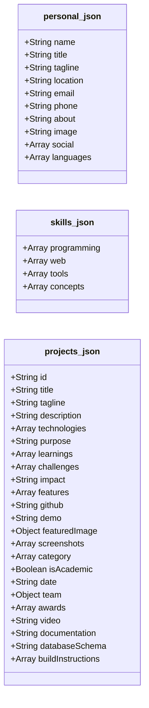
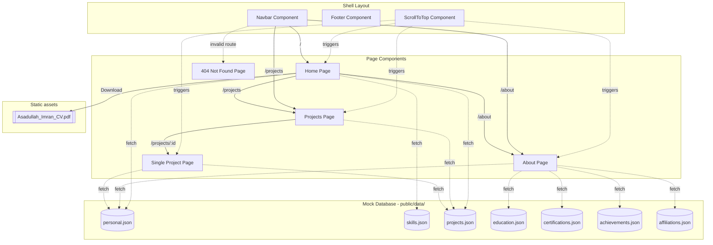

# Portfolio Project - Full Architectural Audit & Breakdown

This document provides a comprehensive audit and architectural breakdown of the portfolio project. It details the project organization, page routing, database schemas, internal connections, styling patterns, design aesthetics, and the resolved issues.

---

## 1. Directory Structure & Organization

The project is structured as a modern single-page application (SPA) using React, Vite, and Tailwind CSS.

```
├── public/                     # Static files directly served to the browser
│   ├── data/                   # JSON "Database" files containing all portfolio copy
│   │   ├── achievements.json
│   │   ├── affiliations.json
│   │   ├── certifications.json
│   │   ├── education.json
│   │   ├── personal.json
│   │   ├── projects.json
│   │   └── skills.json
│   ├── docs/                   # PDF documents (CV/Resume)
│   │   └── Asadullah_Imran_CV.pdf
│   ├── images/                 # Image assets sorted by category
│   │   ├── affiliations/
│   │   ├── awards/
│   │   ├── certifications/
│   │   ├── profile/
│   │   └── projects/
│   ├── imran_logo.png          # Developer favicon logo
│   └── inu.png                 # Alternate favicon
├── src/                        # React source code
│   ├── assets/                 # SVGs and images processed by bundler
│   ├── components/             # Reusable shell layout components (Navbar, Footer, ScrollToTop)
│   ├── pages/                  # Page-level components
│   │   ├── About.jsx
│   │   ├── Home.jsx
│   │   ├── NotFound.jsx
│   │   ├── Projects.jsx
│   │   └── SingleProject.jsx
│   ├── App.jsx                 # App shell, routing setup
│   ├── index.css               # CSS entry point with custom animations
│   └── main.jsx                # DOM entry mount point
├── eslint.config.js            # Linter settings
├── vite.config.js              # Bundler and Tailwind plugins configuration
└── package.json                # NPM package config & dependencies
```

---

## 2. Page & Routing Breakdown

There are **4 pages** (plus 1 wildcard error page) configured in the router inside [App.jsx](file:///Users/imran/Developer/Running_Project/asadullah-imran.github.io/src/App.jsx).

| # | Page Component | Route Path | File Location | Sizing | Purpose & Core Content |
|---|----------------|------------|---------------|--------|------------------------|
| 1 | **Home** | `/` | [Home.jsx](file:///Users/imran/Developer/Running_Project/asadullah-imran.github.io/src/pages/Home.jsx) | ~20 KB | Hero banner (with direct CV download CTA), skills grids, featured projects list, CTA. |
| 2 | **About** | `/about` | [About.jsx](file:///Users/imran/Developer/Running_Project/asadullah-imran.github.io/src/pages/About.jsx) | ~23 KB | Biography, education history timeline, achievements, certifications, club affiliations, languages. |
| 3 | **Projects** | `/projects` | [Projects.jsx](file:///Users/imran/Developer/Running_Project/asadullah-imran.github.io/src/pages/Projects.jsx) | ~14 KB | Full projects catalog, working category sorting/filters (All/Web/Academic), tag display. |
| 4 | **Single Project** | `/projects/:id` | [SingleProject.jsx](file:///Users/imran/Developer/Running_Project/asadullah-imran.github.io/src/pages/SingleProject.jsx) | ~27 KB | Project details loaded by unique slug `id` (e.g. `cinematch`), features, learnings, screenshots carousel, team members. |
| 5 | **Not Found** | `*` (Wildcard) | [NotFound.jsx](file:///Users/imran/Developer/Running_Project/asadullah-imran.github.io/src/pages/NotFound.jsx) | ~2 KB | Custom themed, animated 404 page for invalid routes. |

---

## 3. Data Model & Mock "Database"

The application uses local JSON files located in `public/data/` as a static, document-oriented database. This decouples the portfolio content from UI code, allowing for content updates without modifying React components.



### JSON Datasets Audit
1. [personal.json](file:///Users/imran/Developer/Running_Project/asadullah-imran.github.io/public/data/personal.json) (1.2 KB)
   - *Fields*: `name`, `title`, `tagline`, `location`, `email`, `phone`, `about`, `image`, `social` (array of name/url/icon), `languages` (array of name/level).
2. [skills.json](file:///Users/imran/Developer/Running_Project/asadullah-imran.github.io/public/data/skills.json) (1.1 KB)
   - *Fields*: `programming` (name/level), `web` (name/level), `tools` (array of strings), `concepts` (array of strings).
3. [projects.json](file:///Users/imran/Developer/Running_Project/asadullah-imran.github.io/public/data/projects.json) (13.9 KB)
   - *Fields*: Represents **4 detailed projects** (CineMatch, Monster Munchkins, Exam Routine Generator, Likhalikhi). Rich fields include unique slug `id` keys, screenshots galleries, and team structures.
4. [education.json](file:///Users/imran/Developer/Running_Project/asadullah-imran.github.io/public/data/education.json) (0.7 KB)
   - *Fields*: 3 academic milestones (BSc in CSE at UIU, HSC at Barishal Govt, SSC at Udayan).
5. [certifications.json](file:///Users/imran/Developer/Running_Project/asadullah-imran.github.io/public/data/certifications.json) (1.0 KB)
   - *Fields*: 5 certifications from Meta on Coursera (React, JS, HTML/CSS, Git).
6. [achievements.json](file:///Users/imran/Developer/Running_Project/asadullah-imran.github.io/public/data/achievements.json) (0.9 KB)
   - *Fields*: 3 awards/contests (AOOP Champion, UIHP holder, ICPC participant).
7. [affiliations.json](file:///Users/imran/Developer/Running_Project/asadullah-imran.github.io/public/data/affiliations.json) (0.5 KB)
   - *Fields*: 2 organizations (UIU Computer Club, IDP Roadshow).

---

## 4. Connections & Data Flow Map

The website runs fully client-side. The following diagram illustrates how the pages hook into data sources and route between each other:



---

## 5. Design & Aesthetic Audit

1. **Styling Engine**: The app uses Tailwind CSS v4 via `@tailwindcss/vite`. It loads variables directly from the new `@import "tailwindcss";` directive in [index.css](file:///Users/imran/Developer/Running_Project/asadullah-imran.github.io/src/index.css).
2. **Harmonious Palette**:
   - **Primary Teal**: `#089BAB` (used for highlights, active links, tags)
   - **Secondary Orange**: `#FF9801` (used for achievements, accents, category buttons)
   - **Deep Blue**: `#002B48` (main dark color for backgrounds, strong headings, nav text)
   - **Subtle Aqua Light**: `#E1F5F6` (light gradient backdrops, card borders)
3. **Animations**: Built using `framer-motion` (via spring curves, stagger animations, float loops, rotate loop). Offers premium hover effects on projects, certifications, and links.
4. **Icons**: Uniformly uses FontAwesome icons through the modern `react-icons/fa` package.

---

## 6. Resolved Architectural Issues

During the architectural audit and refactoring, the following issues were resolved to establish a production-grade standard:

1. **Broken Contact Link (Fixed)**:
   - The CTA block at the bottom of [SingleProject.jsx](file:///Users/imran/Developer/Running_Project/asadullah-imran.github.io/src/pages/SingleProject.jsx) originally referenced `/contact` causing 404s. It now dynamically reads `personal.json` and opens a direct mail client to `mailto:asadullahimran19@gmail.com`.
2. **Orphaned /resume Route & Section (Cleaned)**:
   - The placeholder `/resume` route and [Resume.jsx](file:///Users/imran/Developer/Running_Project/asadullah-imran.github.io/src/pages/Resume.jsx) page have been removed. CV downloads are now handled directly from the Home page hero block pointing to the static `/docs/Asadullah_Imran_CV.pdf`.
3. **Index-Based Dynamic Routing (Fixed)**:
   - Dynamic routing was fragile because filtering projects by category caused the map indexing `idx` to point details pages to incorrect projects. This has been resolved by assigning stable slug `id` keys to each project block in [projects.json](file:///Users/imran/Developer/Running_Project/asadullah-imran.github.io/public/data/projects.json) (e.g. `cinematch`, `monster-munchkins`) and looking up values in [SingleProject.jsx](file:///Users/imran/Developer/Running_Project/asadullah-imran.github.io/src/pages/SingleProject.jsx) using `.find()`.
4. **Category Filtering Bug (Fixed)**:
   - Category filtering in [Projects.jsx](file:///Users/imran/Developer/Running_Project/asadullah-imran.github.io/src/pages/Projects.jsx) was completely broken because `typeof p.category === "string"` checks failed on the array formats in the JSON. The code now extracts and matches both string and array categorizations.
5. **Asset Path Discrepancy (Fixed)**:
   - Legacy `"assets/images/..."` values inside JSON entries have been refactored to use standard web-root absolute paths (`"/images/..."`). Redundant runtime `.replace(...)` functions have been completely cleaned out of all JSX pages.
6. **Missing Catch-All Route (Fixed)**:
   - Added a themed, animated [NotFound.jsx](file:///Users/imran/Developer/Running_Project/asadullah-imran.github.io/src/pages/NotFound.jsx) page mapped to `*` to catch invalid route paths.
7. **Scroll Position Retention (Fixed)**:
   - Added [ScrollToTop.jsx](file:///Users/imran/Developer/Running_Project/asadullah-imran.github.io/src/components/ScrollToTop.jsx) to make sure page transitions scroll the viewport back to the top automatically.
8. **Removed Blog Section (Cleaned)**:
   - Completely deleted the unused Blog pages (`Blog.jsx`, `SingleBlog.jsx`) and dataset mock arrays (`blog.json`) to minimize JS bundle footprint and keep a focused resume-portfolio layout.

