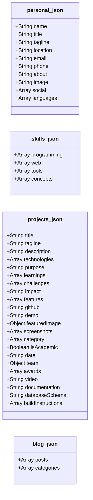
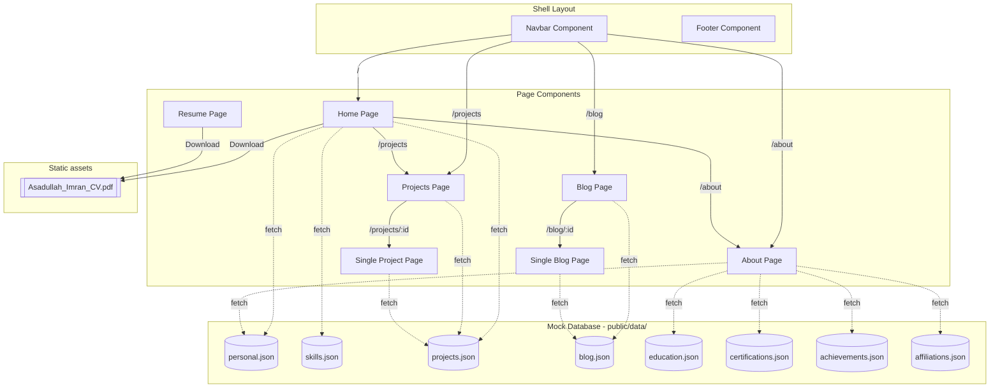

# Portfolio Project - Full Architectural Audit & Breakdown

This document provides a comprehensive audit and architectural breakdown of the portfolio project. It details the project organization, page routing, database schemas, internal connections, styling patterns, design aesthetics, and critical issues/recommendations for improvement.

---

## 1. Directory Structure & Organization

The project is structured as a modern single-page application (SPA) using React, Vite, and Tailwind CSS. The configuration files are clean, and the source/static assets are highly organized.

```
├── .vite/                      # Vite cache directory
├── public/                     # Static files directly served to the browser
│   ├── data/                   # JSON "Database" files containing all portfolio copy
│   ├── docs/                   # PDF documents (CV/Resume)
│   ├── images/                 # Image assets sorted by category
│   ├── imran_logo.png          # Developer favicon logo
│   └── inu.png                 # Alternate favicon
├── src/                        # React source code
│   ├── assets/                 # SVGs and images processed by bundler
│   ├── components/             # Reusable shell layout components
│   ├── pages/                  # Page-level components
│   ├── App.jsx                 # App shell, routing setup
│   ├── index.css               # CSS entry point with custom animations
│   └── main.jsx                # DOM entry mount point
├── eslint.config.js            # Linter settings
├── vite.config.js              # Bundler and Tailwind plugins configuration
└── package.json                # NPM package config & dependencies
```

---

## 2. Page & Routing Breakdown

There are **7 pages** configured in the router inside [App.jsx](file:///Users/imran/Developer/Running_Project/asadullah-imran.github.io/src/App.jsx). 

| # | Page Component | Route Path | File Location | Sizing | Purpose & Core Content |
|---|----------------|------------|---------------|--------|------------------------|
| 1 | **Home** | `/` | [Home.jsx](file:///Users/imran/Developer/Running_Project/asadullah-imran.github.io/src/pages/Home.jsx) | ~20.4 KB | Hero banner, brief introduction, skills grids, featured projects list (top 3), CTA. |
| 2 | **About** | `/about` | [About.jsx](file:///Users/imran/Developer/Running_Project/asadullah-imran.github.io/src/pages/About.jsx) | ~23.0 KB | Biography, education history timeline, achievements, certifications, club affiliations, languages. |
| 3 | **Projects** | `/projects` | [Projects.jsx](file:///Users/imran/Developer/Running_Project/asadullah-imran.github.io/src/pages/Projects.jsx) | ~13.8 KB | Full projects catalog, category sorting/filters (All/Web/Academic), tag display, link overlays. |
| 4 | **Single Project** | `/projects/:id` | [SingleProject.jsx](file:///Users/imran/Developer/Running_Project/asadullah-imran.github.io/src/pages/SingleProject.jsx) | ~26.4 KB | Project detail view: features, challenge/learnings, screenshots carousel, team members, awards, demo video, build instructions. |
| 5 | **Blog** | `/blog` | [Blog.jsx](file:///Users/imran/Developer/Running_Project/asadullah-imran.github.io/src/pages/Blog.jsx) | ~9.3 KB | Blog listing page with search/filters by category, read time, and publish dates. |
| 6 | **Single Blog** | `/blog/:id` | [SingleBlog.jsx](file:///Users/imran/Developer/Running_Project/asadullah-imran.github.io/src/pages/SingleBlog.jsx) | ~14.5 KB | Blog reader with a reading progress bar, dynamic text blocks (headings, lists, code snippet renderer), and social share helper. |
| 7 | **Resume** | `/resume` | [Resume.jsx](file:///Users/imran/Developer/Running_Project/asadullah-imran.github.io/src/pages/Resume.jsx) | ~0.7 KB | Minimal page housing a manual download button for the CV document. |

---

## 3. Data Model & Mock "Database"

The application uses local JSON files located in `public/data/` as a static, document-oriented database. This decouples the portfolio content from UI code, allowing for content updates without modifying React components.



### JSON Datasets Audit
1. [personal.json](file:///Users/imran/Developer/Running_Project/asadullah-imran.github.io/public/data/personal.json) (1.2 KB)
   - *Fields*: `name`, `title`, `tagline`, `location`, `email`, `phone`, `about`, `image`, `social` (array of name/url/icon), `languages` (array of name/level).
2. [skills.json](file:///Users/imran/Developer/Running_Project/asadullah-imran.github.io/public/data/skills.json) (1.1 KB)
   - *Fields*: `programming` (name/level), `web` (name/level), `tools` (array of strings), `concepts` (array of strings).
3. [projects.json](file:///Users/imran/Developer/Running_Project/asadullah-imran.github.io/public/data/projects.json) (13.9 KB)
   - *Fields*: Represents **4 detailed projects** (CineMatch, Monster Munchkins, Exam Routine Generator, Likhalikhi). Rich fields include: links, screenshots gallery, build instructions, awards, and team structures.
4. [blog.json](file:///Users/imran/Developer/Running_Project/asadullah-imran.github.io/public/data/blog.json) (8.9 KB)
   - *Fields*: Contains **3 mock posts** (GitHub, Accounting, Networking) along with a `categories` index count. Posts use a nested `sections -> blocks` architecture supporting texts, custom links, code blocks, and illustrations.
5. [education.json](file:///Users/imran/Developer/Running_Project/asadullah-imran.github.io/public/data/education.json) (0.7 KB)
   - *Fields*: 3 academic milestones (BSc in CSE at UIU, HSC at Barishal Govt, SSC at Udayan).
6. [certifications.json](file:///Users/imran/Developer/Running_Project/asadullah-imran.github.io/public/data/certifications.json) (1.0 KB)
   - *Fields*: 5 certifications from Meta on Coursera (React, JS, HTML/CSS, Git).
7. [achievements.json](file:///Users/imran/Developer/Running_Project/asadullah-imran.github.io/public/data/achievements.json) (0.9 KB)
   - *Fields*: 3 awards/contests (AOOP Champion, UIHP holder, ICPC participant).
8. [affiliations.json](file:///Users/imran/Developer/Running_Project/asadullah-imran.github.io/public/data/affiliations.json) (0.5 KB)
   - *Fields*: 2 organizations (UIU Computer Club, IDP Roadshow).

---

## 4. Connections & Data Flow Map

The website runs fully client-side. The following diagram illustrates how the pages hook into data sources and route between each other:



---

## 5. Design & Aesthetic Audit

1. **Styling Engine**: The app uses Tailwind CSS v4 via `@tailwindcss/vite`. It loads variables directly from the new `@import "tailwindcss";` directive in [index.css](file:///Users/imran/Developer/Running_Project/asadullah-imran.github.io/src/index.css).
2. **Harmonious Palette**: The core colors in code differ slightly from the static `colorTheme.md` file but maintain a cohesive, clean look:
   - **Primary Teal**: `#089BAB` (used for highlights, active links, tags)
   - **Secondary Orange**: `#FF9801` (used for achievements, accents, category buttons)
   - **Deep Blue**: `#002B48` (main dark color for backgrounds, strong headings, nav text)
   - **Subtle Aqua Light**: `#E1F5F6` (light gradient backdrops, card borders)
3. **Animations**: Built using `framer-motion` (via spring curves, stagger animations, float loops). Highly engaging, offering premium hover effects on projects, certifications, and links.
4. **Icons**: Uniformly uses FontAwesome icons through the modern `react-icons/fa` package.

---

## 6. Detailed Code Audit & Discovered Issues

During this audit, several inconsistencies, bugs, and areas of improvement were identified:

### ⚠️ Critical Inconsistencies & Bugs
1. **Broken Contact Link (404 Route)**:
   - **Location**: [SingleProject.jsx (Line 646)](file:///Users/imran/Developer/Running_Project/asadullah-imran.github.io/src/pages/SingleProject.jsx#L646)
   - **Issue**: The Call to Action (CTA) block at the bottom of the page references `<Link to="/contact" ...>Contact Me</Link>`. However, there is no `/contact` route declared in `App.jsx`, causing a blank/broken page transition if a user clicks it.
   
2. **Orphaned `/resume` Route**:
   - **Location**: [App.jsx (Line 22)](file:///Users/imran/Developer/Running_Project/asadullah-imran.github.io/src/App.jsx#L22) & [Navbar.jsx](file:///Users/imran/Developer/Running_Project/asadullah-imran.github.io/src/components/Navbar.jsx)
   - **Issue**: The router includes a path `/resume` mapped to `Resume.jsx`. However, this page is not referenced anywhere in the navigation menu (`Navbar` or `Footer`). Users can only visit it by manually entering the URL.

3. **Index-Based Dynamic Routing (Fragile ID Keys)**:
   - **Location**: [SingleProject.jsx (Line 30)](file:///Users/imran/Developer/Running_Project/asadullah-imran.github.io/src/pages/SingleProject.jsx#L30)
   - **Issue**: The individual projects page fetches data using an array index ID matching the route param (e.g., `/projects/0` refers to CineMatch). If the order of elements in `projects.json` is modified, URLs will point to different projects, breaking bookmarks and indexing. In contrast, the blog page uses explicit unique IDs (`/blog/1`).

4. **Asset Path Discrepancy (Runtime Patching)**:
   - **Location**: Across all page files (`Home.jsx`, `About.jsx`, etc.)
   - **Issue**: Image paths in JSON files are configured as `"assets/images/..."` (legacy locations), but the files have been moved to `public/images/`. The code resolves this by running `image.replace("assets/images", "/images")` at runtime. While it works, it introduces unnecessary technical debt.

5. **Missing Catch-All Route (404 Page)**:
   - **Location**: [App.jsx](file:///Users/imran/Developer/Running_Project/asadullah-imran.github.io/src/App.jsx)
   - **Issue**: There is no wildcard `*` route in `App.jsx`. Accessing any undefined URL (e.g. `/invalid-page`) displays a blank screen inside `<main>` instead of showing a friendly "Page Not Found" screen.

---

## 7. Strategic Recommendations

To bring the codebase to a production-grade standard, the following steps are recommended:

*   **Fix Broken Links**: Update the CTA in `SingleProject.jsx` to direct to `mailto:asadullahimran19@gmail.com` or create a contact section/form on the homepage.
*   **Establish Unique Project Slugs**: Add a unique `slug` field to each item in `projects.json` (e.g. `"slug": "cinematch"`) and change routing from `/projects/:id` to `/projects/:slug`.
*   **Resolve Asset Paths**: Update path entries in the JSON data directory to match the actual file system structure (`/images/...`) and remove the redundant `replace(...)` functions from JSX files.
*   **Add a 404 Page Component**: Add a wildcard route at the bottom of `<Routes>` that renders a stylish "Page Not Found" template with a button redirecting back to `/`.
*   **Expose Resume in Nav or Deprecate Page**: If the `/resume` page is necessary, add it to the Navbar. Otherwise, remove the route and direct CV links directly to the downloadable static PDF.
